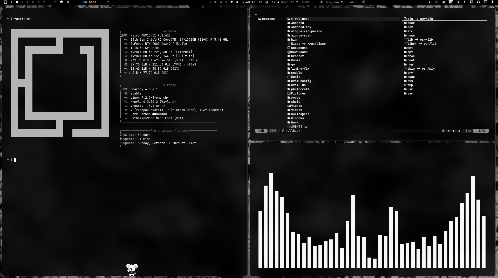

# dark-carbon (tema Omarchy)

Tema oscuro personalizado para Omarchy (Hyprland). Incluye ajustes de
**transparencia de terminal con difuminado** (blur de fondo).



## Ajustes incluidos

| Terminal  | Config | Transparencia | Difuminado |
|-----------|--------|---------------|-----------|
| Ghostty   | `ghostty.conf` | `background-opacity = 0.8` | `background-blur-radius = 20` |
| Kitty     | `kitty.conf` | `background_opacity 0.8` | (compositor) |
| Alacritty | `alacritty.toml` | `opacity = 0.8` | (compositor) |

El blur del compositor lo habilita `~/.config/hypr/looknfeel.lua`
(`decoration.blur.enabled = true`, `xray = true`).

## Neovim

`colors.toml` originalmente es casi monocromático (todos los grises), por lo que
los grupos de sintaxis en Neovim se veían iguales. El tema incluye `neovim.lua`
con la estética de [oxocarbon.nvim](https://github.com/nyoom-engineering/oxocarbon.nvim):
predomina el **negro carbón** `#161616` como fondo (escala de grises derivada
del carbón) y los acentos **IBM Carbon** (`#78a9ff` azul keywords, `#ff7eb6`
funciones, `#be95ff` strings/constantes, `#82cfff` números, `#ee5396`
propiedades). Solo afecta a este tema: al aplicar un tema con
`neovim.lua` propio, la plantilla generada no lo sobreescribe.

## Uso

```bash
# Aplicar el tema
omarchy theme set "Dark Carbon"

# Instalar desde un repo
omarchy theme install https://github.com/Madmasx/dark-carbon
```

## Importante (transparencia + updates)

Los `.conf` de terminal forman parte del tema y se copian tal cual **solo si
el tema es "escrito por el usuario"** (carpeta `~/.config/omarchy/themes/`
sin `.git`). Si se instala vía `omarchy theme install`, Omarchy descarta
`ghostty.conf` / `kitty.conf` / `alacritty.toml` del tema y los regenera desde
plantillas — por eso en la máquina activa **no** inicializar git dentro de
`~/.config/omarchy/themes/dark-carbon/`. Mantener los archivos de terminal
(modificados con transparencia) en el tema garantiza que sobrevivan a
cualquier `omarchy update`, que nunca toca `~/.config/`.

Para subtituir los videos de fondo, copiarlos a `backgrounds/` (ver `.gitignore`).

## `$ ls ~/contacto`

[](https://x.com/madmasx)
[](https://github.com/madmasx)
[](https://buymeacoffee.com/madmasx)